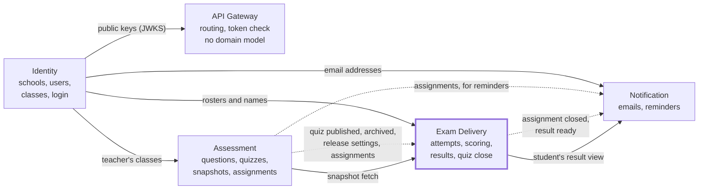
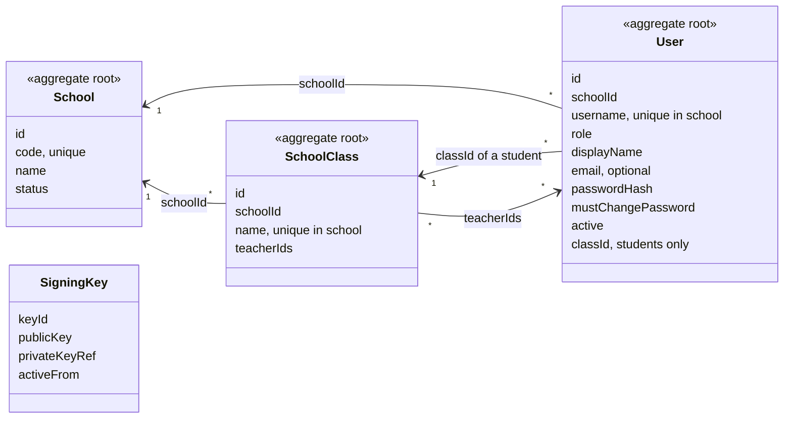
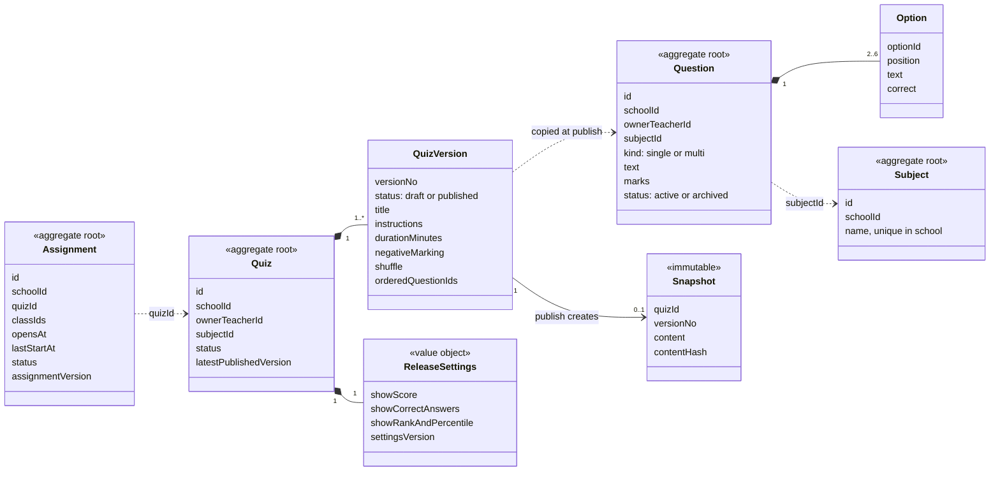
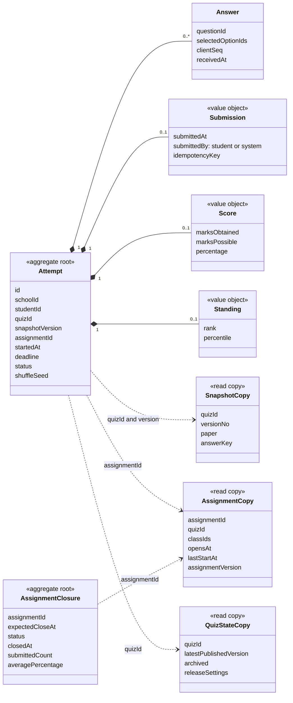
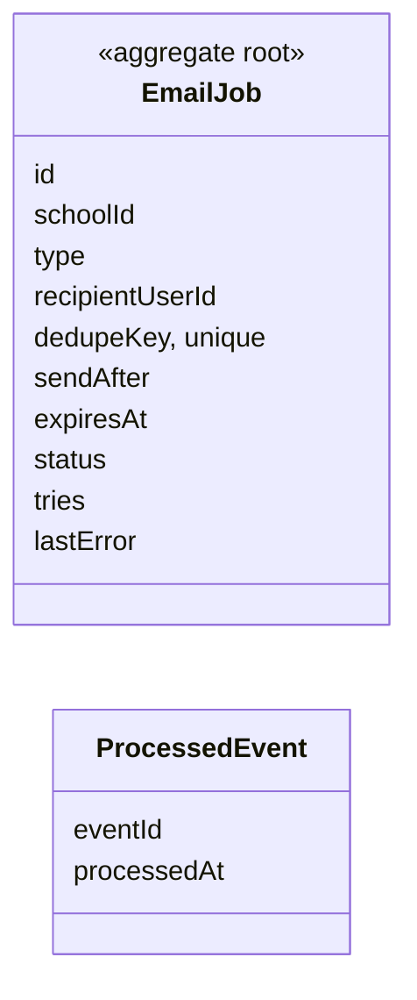
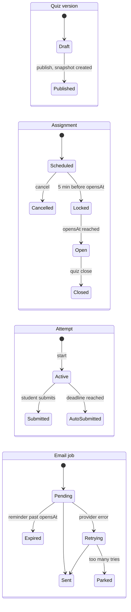

# Online Exams Platform — Domain Model and Context Map

| | |
| --- | --- |
| Issue | BAC-9 |
| Version | v1.2 draft, 20 Nov 2026 (v1.2 names token claims as in ADR-004; v1.1 applied the six confirmed rules in section 13.2) |
| Owner | Khushboo and Ankit |
| Covers | POC (Phase 1) and MVP (Phase 2) in detail; later contexts in outline |
| Builds on | BAC-6 (functional requirements, business rules, glossary), BAC-7 (NFRs), BAC-8 (capacity, scale-ready rules) |
| Feeds | BAC-10 (ADRs, including ADR-003 database per service), API design (BAC-18), the answers schema (BAC-31), Phase 1 code |
| In the repo | Commit as `docs/domain-model.md` |

## 1. How to read this document

- A **bounded context** is a part of the domain where each term has one meaning and one owner. Here each context is one service.
- An **aggregate** is a cluster of objects that changes together in one transaction. Its **root** is the only entry point, and it enforces the business rules (BR-n) for everything inside.
- An **entity** has an identity that lasts (an attempt). A **value object** is defined only by its values (a score).
- A **domain event** is a fact that already happened, published for other contexts (`AssignmentClosed`).
- A **read copy** is data another context owns, kept locally so a service can work without calling the owner. The holder never edits it; only the owner's events or API change it.
- **Across contexts, objects are referenced by ID only.** There are no cross-service joins or foreign keys (architecture principle 5).
- Diagrams are Mermaid. In the context map, an arrow shows which way data flows. A solid line is a synchronous REST call, and a dotted line is an event.

## 2. The answer on one page

| Question | Answer |
| --- | --- |
| How many contexts in the MVP? | Four with a domain model: Identity, Assessment, Exam Delivery, Notification. The gateway has none. |
| Why these four? | Each differs from the others in scaling profile, failure mode, data owned or release cadence (section 3) |
| Where do classes live? | In Identity, with users. This settles a conflict between BAC-6 and the architecture doc (section 3.3). |
| What does the exam path call at run time? | Nothing outside Exam Delivery. The token carries the student's school, role and class; snapshots, assignments and release settings are read copies (section 11). |
| How does a quiz reach Exam Delivery? | As an immutable snapshot. In Phase 1, Exam Delivery fetches it over REST. From Phase 2, an event says a version was published and Exam Delivery fetches it once (section 10). |
| Who holds names and emails? | Only Identity. Other contexts hold user IDs and look names up when they need them (section 7). |
| Which invariants need the database? | One attempt per student per assignment, and usernames unique per school, are unique indexes. No single aggregate can see all rows (section 5). |
| Decided here | 8 design decisions (section 13.1). The architecture doc is updated to match. |
| Rules confirmed | 6 rules, including a quiz lock during exams, applied to BAC-6 v1.3 (section 13.2) |

## 3. Bounded contexts and why each is separate

### 3.1 The four contexts

The architecture's first principle says a service needs its own reason to exist. This table is that evidence.

| Context (service) | Owns | Scaling profile | Failure mode it must not spread | Release cadence |
| --- | --- | --- | --- | --- |
| **Identity** | Schools, users, roles, credentials, classes and class membership, token signing keys | Bursts of logins before an exam (BAC-8: CPU-bound password hashing, about 14 per second on the free VM) | If it is down, new logins fail, but students already logged in keep their exams, because tokens are checked locally | Rare; security-critical |
| **Assessment** | Subjects, question bank, quizzes, quiz versions, snapshots, release settings, assignments | Low and steady: teachers authoring during the day | A slow bulk edit or export must not slow a live exam (NFR-27) | Frequent; most new features land here |
| **Exam Delivery** | Attempts, answers, submissions, scores, ranks and percentiles, quiz close | Bursts of 200 starts per second at exam start, and write-heavy (BAC-8: about 1 read to 10 writes) | It must keep running while Assessment, Identity or Notification are down | Careful; it changes only with tests against NFR-13 (zero lost answers) |
| **Notification** | Email jobs, their status, retries, expiry and deduplication | Spiky after quiz close; bounded by the email quota (NFR-69) | A slow or failing email provider never blocks an exam or a result (FR-55) | Independent; templates change often |

BAC-6's requirements map onto these contexts:
- **Identity:** section 3.1.
- **Assessment:** sections 3.2 and 3.3, apart from sending reminders.
- **Exam Delivery:** sections 3.4 and 3.5, plus results (FR-47 to FR-52, FR-56, FR-58).
- **Notification:** emails (FR-31 sending, FR-53 to FR-55).

### 3.2 Splits we rejected, and why

| Candidate | Why it stays inside another context |
| --- | --- |
| Scoring as its own service | Scoring needs the answer key and the answers in the same transaction as the submission (BR-10, FR-43). A split would turn one transaction into a distributed one, for no different scaling need. It becomes the Grading service only when scoring gets expensive (Phase 5). |
| Results or Reporting as its own service | Results are a read of Exam Delivery's own tables. A separate read model (CQRS) is worth it only if report queries measurably slow exams (Phase 4). |
| Scheduling (assignments) as its own service | Assignments are written by the same teachers, at the same rate, as quizzes. They lock 5 minutes before the window opens (BR-12). |
| A separate School Directory service for classes | Classes and users are managed by the same admin, imported in the same CSV (FR-3), and read together. Identity hosts both. |

### 3.3 Classes belong to Identity, not Assessment

The architecture doc listed classes under Assessment, and BAC-6 put FR-11 (classes) under Identity. They cannot both own them. **Identity owns classes and class membership.** Three reasons:

1. **FR-3 is all-or-nothing.** A CSV import creates students *and* places them in classes, and one bad row must import nothing. With users and classes in one service, that is one local transaction. Across two services it would need a saga to undo half an import.
2. **A student belongs to one class** (FR-11). That is an attribute of the student, `User.classId`, enforced by the user row itself.
3. **The admin manages rosters with users.** Teachers only *use* classes when they assign a quiz.

Assessment and Exam Delivery reference classes by ID. Section 8 shows how they check membership without a join.

## 4. Context map



*Arrows show data flow. Solid: a REST call made by the receiving side. Dotted: an event. Exam Delivery, highlighted, receives data but calls nobody on the exam path.*

| Upstream | Downstream | DDD relationship | What flows | Phase |
| --- | --- | --- | --- | --- |
| Identity | Every service, through the gateway | **Open host service** with a **published language**: the token claims and the public keys | `sub` (user ID), `tenant` (school ID), `roles`, and for students `classId` | POC (`classId`: MVP) |
| Identity | Assessment, Exam Delivery, Notification | Open host service: internal lookup endpoints | Teacher's class IDs; class rosters with names; email addresses | MVP |
| Assessment | Exam Delivery | **Customer–supplier**. Exam Delivery is the customer, and its needs shape the contract. Exam Delivery puts an **anticorruption layer** on its side, translating a snapshot into its own `Paper` and `AnswerKey`. | Snapshots, quiz status, release settings, assignments | POC (snapshot), MVP (the rest) |
| Assessment | Notification | Customer–supplier; Notification is **conformist** (it takes the event as given) | Assignment schedule, for reminders | MVP |
| Exam Delivery | Notification | Customer–supplier; Notification is conformist | Assignment closed; result ready; the student's result view at send time | MVP |
| — | — | **No shared kernel.** No domain classes are shared; `libs/` holds only technical helpers (architecture doc). Each service has its own Java types for each contract. | — | All |

## 5. Domain model by context

Aggregate roots are marked. Every aggregate carries `schoolId` (BR-1). IDs are UUIDs generated by the owning service.

### 5.1 Identity



| Aggregate | Holds | Rules it enforces | Note |
| --- | --- | --- | --- |
| School | Code, name, status | School code is unique (FR-1) | Unique index on `code` |
| User | Profile, role, credentials, active flag, the student's class | One school, one role; username unique in its school (BR-2); temporary password forces a change (FR-6); deactivation keeps results (BR-15) | Uniqueness across users is a unique index on (`school_id`, `username`), because no single user can see the others |
| SchoolClass | Name, teacher IDs | Name unique in the school | A student's membership lives on the student (`User.classId`), so "one class per student" needs no extra check |
| SigningKey | Key pair metadata | Tokens are signed with RS256; the public keys are published for the gateway | Key rotation in v1 |

### 5.2 Assessment



| Aggregate | Holds | Rules it enforces | Note |
| --- | --- | --- | --- |
| Subject | Name | Unique name in the school (FR-13) | Unique index |
| Question | Text, options, key, marks, status | 2 to 6 options; at least one correct; single-correct has exactly one (FR-14); archived, never deleted, once published (BR-14) | Editing a question never touches a snapshot, because publishing copies it (FR-15) |
| Quiz | Its versions, release settings, status | At most one draft version at a time; a published version is immutable (BR-3); publishing validates the draft (FR-19); an archived quiz cannot be started (FR-21); no edit, republish or archive while any of its assignments is in its exam period (BR-20) | Release settings sit on the quiz, outside any version, because they never change a score (BR-17). Assessment checks BR-20 against its own assignments, ending the lock at the expected close (`lastStartAt` plus duration plus grace). Publishing and changing an assignment both lock the quiz row, so they cannot race. |
| Snapshot | The frozen content of one version | Written once by publish; never updated | Section 10 is its contract |
| Assignment | Quiz ID, class IDs, start window | Classes and window change only until 5 minutes before the window opens; `opensAt` is at least 5 minutes away when set (BR-12); the teacher must teach every class (FR-27) | References the quiz, not a version. The quiz can't be republished during the exam period (BR-20), so every student in one assignment sits the same version. |

### 5.3 Exam Delivery



| Aggregate | Holds | Rules it enforces | Note |
| --- | --- | --- | --- |
| Attempt | Times, status, answers, submission, score, standing | Bound to one snapshot version (BR-4); the server sets the deadline (BR-7); answers only before deadline plus grace (BR-8); newest answer per question wins (BR-9); submitted exactly once (BR-10); scored from the snapshot's key only (BR-11); start, save and submit are idempotent (BR-16); a student reads only their own attempt, never another's (BR-19) | One attempt per student per assignment (BR-5, BR-6) is a unique index on (`assignment_id`, `student_id`). Concurrent starts collide on it, and the loser returns the existing attempt (FR-33). |
| AssignmentClosure | Close time, status, counts, average | Closes once `lastStartAt` plus grace has passed and no attempt on the assignment is still active (BR-13); computes rank and percentile once (BR-18, FR-58); then publishes `AssignmentClosed` | Exam Delivery owns the close because it is the context that knows when the last attempt ended |

**A large aggregate, written cheaply.** An attempt can hold 200 answers, yet a save never loads them. The save is one guarded upsert: it writes the answer only if the attempt is active, the time is before deadline plus grace, and its `clientSeq` is newer than the stored one, all in one statement. The attempt is still the consistency boundary; the database enforces its rule in place. BAC-8 section 9 needs this: one row per answer, no read before the write.

**Read copies.** `SnapshotCopy`, `AssignmentCopy` and `QuizStateCopy` belong to Assessment. Exam Delivery stores them so the exam path needs no calls. `SnapshotCopy` keeps the paper pre-serialised per version (BAC-8 section 9) and the answer key in a separate column that no student response reads.

### 5.4 Notification



| Aggregate | Holds | Rules it enforces | Note |
| --- | --- | --- | --- |
| EmailJob | One email to one recipient, and its delivery state | Sent at most once per `dedupeKey`, such as `reminder:{assignmentId}:{studentId}` (FR-31); a reminder expires at `opensAt` (FR-31); teacher emails before student emails when the quota is short (NFR-69); retried, then parked (FR-55) | Stores the recipient's user ID, not the address; the address is looked up at send time (section 7) |
| ProcessedEvent | IDs of consumed events | Each event is handled once, even when Kafka delivers it twice | Every consuming service has the same table |

## 6. Lifecycles



- A **quiz** is Draft, Published or Archived as a whole. Editing a published quiz adds a new draft version beside the published one (FR-20), except during an exam period, when the quiz is locked (BR-20).
- An **assignment** can change its classes and window while Scheduled. It locks 5 minutes before `opensAt` and is Open from `opensAt`. From the lock until quiz close nothing about it or its quiz changes (BR-12, BR-20). That is why Exam Delivery's copies are safe to trust during an exam: the 5 minutes give the last change time to arrive.
- An **attempt** never returns to Active (BR-6). Submitted and AutoSubmitted are both scored.

## 7. Data ownership

Every entity has exactly one owner, the only service that writes it.

| Entity | Owner | Who else holds it, and in what form | How they get it |
| --- | --- | --- | --- |
| School | Identity | `schoolId` on every row everywhere | From the token |
| User: profile, role, credentials | Identity | User IDs only (student, teacher, recipient) | From the token, or by lookup |
| User's name and email | Identity | Nobody stores them. Exam Delivery and Notification look them up when needed. | Sync batch lookup |
| SchoolClass and membership | Identity | Assessment: class IDs on assignments. Exam Delivery: class IDs on its assignment copy. The student's `classId` in the token. | Token; sync check when assigning |
| Signing keys | Identity | Gateway: public keys only | JWKS endpoint, cached |
| Subject | Assessment | `subjectId` inside snapshots | Snapshot |
| Question and options | Assessment | Copied into snapshots at publish | Snapshot |
| Quiz, quiz version | Assessment | Exam Delivery: latest published version and archived flag | Events |
| Snapshot | Assessment | Exam Delivery: full read copy, split into paper and key | Event, then REST fetch |
| Release settings | Assessment | Exam Delivery: copy, used for every student read | Events |
| Assignment | Assessment | Exam Delivery and Notification: copies | Events |
| Attempt, answers, submission, score | Exam Delivery | Notification: attempt ID only | Events |
| Rank, percentile, quiz close facts | Exam Delivery | Notification: counts and average in `AssignmentClosed` | Events |
| Email job | Notification | Nobody | — |
| Outbox and processed-event rows | Each service, its own | Nobody | — |

**Why names and emails are never copied.** Personal data in one place means erasure (NFR-45) is one delete plus a `UserErased` event. Other services then delete or anonymise the IDs they hold. It also keeps student data minimal (NFR-41).

## 8. Integration points: sync or async

The rule: **use a synchronous call when the caller needs the current truth to answer now, and the path is low-volume. Use an event when the receiver must keep working while the sender is down, or the work can happen later.**

| Need | From → to | Style | Why |
| --- | --- | --- | --- |
| Check a token | Gateway and every service ← Identity | Local check with cached public keys | Thousands of requests a minute; a call per request would make Identity a single point of failure |
| Is the student in the assigned class? | Exam Delivery ← token | Token claim `classId` | On the exam path; no call allowed. A class change applies at next login (tokens last 4 h, NFR-32). |
| Does the teacher teach this class? | Assessment → Identity | Sync REST | When creating an assignment: low-volume and needs today's truth. If Identity is down, assigning fails; exams do not. |
| Snapshot of a new version | Assessment → Exam Delivery | POC: sync fetch on first start, then stored. MVP: `QuizVersionPublished` event, then one REST fetch. | Immutable, so a copy never goes stale. Section 10 explains the fetch. |
| Quiz archived; release settings changed | Assessment → Exam Delivery | Event | Exam Delivery must answer students while Assessment is down |
| Assignment scheduled, changed, cancelled | Assessment → Exam Delivery, Notification | Event | Same reason; Notification also schedules reminders from it |
| Missing copy (event not yet arrived) | Exam Delivery → Assessment | Sync read-through, once, then stored | Covers event lag without making the exam path depend on Assessment |
| Roster with names, for results and CSV | Exam Delivery → Identity | Sync batch lookup | Teacher path, low-volume; avoids copying names (section 7) |
| Quiz closed | Exam Delivery → Notification | Event | Email is slow work and must never block the close |
| Result ready for a student | Exam Delivery → Notification | Thin event, then a sync fetch of the student's view at send time | The email must show only what the release settings allow *when it is sent* (FR-54) |
| Email address of a recipient | Notification → Identity | Sync lookup at send time | Keeps addresses in one place; a failed lookup is retried like a failed send |
| User erased | Identity → Exam Delivery, Notification | Event | Erasure must reach every service even if one is down (v1, NFR-45) |

## 9. Domain events

Events leave a service through its transactional outbox, so the database change and the event commit together (Phase 2). Every event carries `eventId`, `type`, `occurredAt`, `schemaVersion` and `schoolId`. Consumers record `eventId` and ignore repeats. State events carry a version, and an older version never overwrites a newer one.

| Event | Producer | Topic, key | Consumers | Payload | Style |
| --- | --- | --- | --- | --- | --- |
| `QuizVersionPublished` | Assessment | `assessment.quiz.v1`, `quizId` | Exam Delivery | Quiz ID, version, owner teacher, content hash, size | Thin: a notice to fetch (section 10) |
| `QuizArchived` | Assessment | `assessment.quiz.v1`, `quizId` | Exam Delivery | Quiz ID | State |
| `ReleaseSettingsChanged` | Assessment | `assessment.quiz.v1`, `quizId` | Exam Delivery | Three flags, `settingsVersion` | State |
| `AssignmentScheduled`, `AssignmentChanged`, `AssignmentCancelled` | Assessment | `assessment.assignment.v1`, `assignmentId` | Exam Delivery, Notification | Whole assignment, quiz title, owner teacher, `assignmentVersion` | State |
| `AssignmentClosed` | Exam Delivery | `exam.assignment.v1`, `assignmentId` | Notification | Assignment, quiz title, owner teacher, submitted count, average percentage | State; no personal data |
| `AttemptResultReady` | Exam Delivery | `exam.result.v1`, `attemptId` | Notification | Attempt ID, student ID, assignment ID; no score | Thin: Notification fetches the student's view |
| `UserErased` | Identity | `identity.user.v1`, `userId` | Exam Delivery, Notification | User ID | Notice (v1) |

The three quiz events share one topic keyed by `quizId`, so they arrive in order for each quiz. Attempt-level events inside Exam Delivery (started, saved, submitted) are not published: no other context needs them yet.

## 10. The quiz snapshot contract

The snapshot is the published language between Assessment and Exam Delivery. It is internal, never routed through the gateway, and the only place answer keys leave Assessment.

```json
{
  "schemaVersion": 1,
  "quizId": "q-7f3a",
  "versionNo": 3,
  "schoolId": "s-12ab",
  "ownerTeacherId": "u-90cd",
  "subjectId": "sub-04",
  "publishedAt": "2026-11-23T04:30:00Z",
  "title": "Quadratic equations, weekly test 4",
  "instructions": "Answer all questions.",
  "durationMinutes": 30,
  "negativeMarking": "QUARTER",
  "shuffle": { "questions": true, "options": true },
  "totalMarks": "40.00",
  "questions": [
    {
      "questionId": "qn-551e",
      "position": 1,
      "kind": "SINGLE",
      "text": "Which values of x satisfy x² − 5x + 6 = 0?",
      "marks": "4.00",
      "options": [
        { "optionId": "op-1", "position": 1, "text": "2 and 3" },
        { "optionId": "op-2", "position": 2, "text": "−2 and −3" }
      ],
      "correctOptionIds": ["op-1"]
    }
  ],
  "contentHash": "sha256:9c1e…"
}
```

**Rules.**
- **Identity:** (`quizId`, `versionNo`). A snapshot never changes once written (BR-3); `contentHash` lets the receiver verify it.
- **Served at** `GET /internal/v1/quiz-snapshots/{quizId}/versions/{versionNo}` on Assessment, protected by a service token with a service role (BAC-30).
- **Exact numbers:** marks are decimal strings, never floats (FR-45).
- **Stable IDs:** answers reference `optionId`, so shuffling changes only the order a student sees. Each attempt stores its shuffle seed, so the order survives a resume (FR-24).
- **Settings inside:** `negativeMarking` and `shuffle` are in the snapshot because they change the score or the paper. Release settings are not (BR-17).
- **Evolution:** new optional fields may be added at any time, and receivers ignore fields they don't know. A removal or rename means a new `schemaVersion`, and Assessment serves both until Exam Delivery has moved.
- **On arrival,** Exam Delivery's anticorruption layer splits the snapshot into a `Paper` (what students see: no keys) and an `AnswerKey` (scoring only). It pre-serialises the paper once per version (BAC-8 section 9).

**Why the event carries a notice, not the snapshot.** This is the claim-check pattern: the event says where the data is, and the receiver fetches it.
- **Size.** A quiz can have 200 questions of up to 4,000 characters (BAC-7 limits). In Devanagari, 3 bytes a character in UTF-8, question text alone could reach 2.4 MB. Kafka's default largest record batch is about 1 MB (`message.max.bytes` = 1,048,588). Raising it affects the broker and every consumer.
- **Answer keys stay off the bus.** Any service that can read a topic could read the keys. Fetching over an authenticated internal endpoint keeps them between two services (BR-11).
- **A fetch is safe to repeat.** The snapshot is immutable, so a retried or duplicate fetch returns the same bytes.

Assignments and release settings are small and contain no secrets, so their events carry the whole state.

## 11. Checking each other's data without joins

### 11.1 A student starts an attempt (exam path, zero calls)

1. The gateway checks the token with cached public keys. The token gives `sub` (user ID), `tenant` (school ID), `roles` = student, and `classId` (claims as in ADR-004).
2. Exam Delivery reads its `AssignmentCopy`. It checks, in order: the school matches the token (BR-1); `classId` is in the assignment's classes; now is between `opensAt` and `lastStartAt`; the quiz is not archived (`QuizStateCopy`). Each failure has its own error (FR-42).
3. It takes the latest published `SnapshotCopy` for the quiz.
4. It inserts the attempt. The unique index on (`assignment_id`, `student_id`) turns a second or concurrent start into "return the existing attempt" (FR-33, BR-5).
5. It returns the pre-serialised paper, the deadline and the remaining time (FR-32, FR-37).

If a copy is missing because an event is late, step 2 or 3 reads through to Assessment once and stores the result. In the POC there are no assignments: the check is "quiz is published", and the unique index is on (`quiz_id`, `student_id`).

### 11.2 A teacher opens results (teacher path, one call)

1. Exam Delivery checks that the caller owns the quiz (owner teacher ID from the snapshot copy) or is an admin of the school (FR-49, FR-56).
2. It reads the assignment's attempts with scores, ranks and percentiles from its own tables.
3. It calls Identity once with the assignment's class IDs, and gets back the roster: user IDs and names.
4. It merges the two. Roster students with no attempt are "not attempted" (FR-50). The CSV export (FR-52) uses the same merge.

## 12. POC versus MVP

| Concern | POC (Phase 1) | MVP (Phase 2) |
| --- | --- | --- |
| Contexts running | Identity, Assessment, Exam Delivery | Plus Notification |
| Classes and assignments | None; any student can start any published quiz | Classes in Identity; assignments in Assessment |
| Snapshot to Exam Delivery | Sync fetch on first start, then stored | Event, then one fetch; read-through on a miss |
| One attempt per | (quiz, student) | (assignment, student) |
| Events | None | Outbox and Kafka |
| Release settings, rank, quiz close | Score always shown; no rank or close | Copies in Exam Delivery; `AssignmentClosure` |
| Token claims | `sub`, `tenant`, `roles` (ADR-004) | Plus `classId` for students |

Later contexts, in outline: **Reporting** (Phase 4) is a read model fed by Exam Delivery's events. **Proctoring** (Phase 5) is its own context, with browser events and its own store. **AI Questions** (Phase 5) supplies draft questions to Assessment through an anticorruption layer. **Integrations** (Phase 5) wraps LMS protocols in an anticorruption layer.

## 13. Decisions

### 13.1 Decided here

The architecture doc is updated to match these: Assessment no longer owns classes, and the snapshot is delivered by notice plus fetch.

| # | Decision | Section |
| --- | --- | --- |
| D1 | Identity owns classes and class membership | 3.3 |
| D2 | The student's `classId` travels in the token, so the start path calls nobody | 8, 11.1 |
| D3 | Exam Delivery keeps read copies of snapshots, assignments, quiz state and release settings, fed by events, with a read-through on a miss | 5.3, 8 |
| D4 | Snapshots travel as a notice plus a REST fetch (claim check); assignments and settings travel whole | 10 |
| D5 | Names and emails stay in Identity; other services look them up | 7 |
| D6 | Student result emails are built from the student's view fetched at send time | 8, 9 |
| D7 | Exam Delivery owns quiz close, rank and percentile, through `AssignmentClosure` | 5.3 |
| D8 | No shared kernel: no domain classes are shared between services | 4 |

### 13.2 Confirmed on 20 Nov 2026, and applied to BAC-6 v1.3

| # | Rule | Why | BAC-6 |
| --- | --- | --- | --- |
| C1 | The newest answer is the one with the highest client sequence number for that question, not the last to arrive | FR-35 says an older save arriving late must not overwrite a newer one. Arrival order can't tell them apart; a client sequence number can. | BR-9, FR-35 |
| C2 | The shuffle setting is part of the snapshot, like negative marking | It shapes the paper | BR-17, FR-24 |
| C3 | Rank and percentile order by percentage, not marks | Gives the same order as marks while all attempts share one version (C6), and stays right if two versions ever meet in one ranking | BR-18, FR-58 |
| C4 | Assignments lock 5 minutes before `opensAt`; `opensAt` must be at least 5 minutes away when set | Gives the change event time to reach Exam Delivery and Notification before the first student starts | BR-12, FR-28, FR-29 |
| C5 | Quiz close happens once `lastStartAt` plus grace has passed and no attempt on the assignment is still active | Auto-submit guarantees the "no active attempt" part by `lastStartAt` plus duration plus grace | BR-13 |
| C6 | No edit, republish or archive of a quiz during any of its assignments' exam periods (from the lock until quiz close). Release settings can still change. | Added by you. Every student in one assignment sits the same version, and the paper never changes mid-exam. | New BR-20, FR-20, FR-21 |

## 14. Review questions for you

Answer these before we close BAC-9; I'll push back on each. The first two are the interview questions on the Linear issue.

- [ ] How did you decide your service boundaries? Use the table in section 3, and name one split you rejected and why.
- [ ] How do services reference each other's data without cross-database joins? Walk through section 11.1 and 11.2 from memory.
- [ ] Why do classes live in Identity? What would FR-3 need if they lived in Assessment?
- [ ] Exam Delivery trusts its copy of an assignment during an exam. Which business rule makes that safe, and where could a stale copy still hurt?
- [ ] An attempt holds up to 200 answers, yet a save never loads them. Is it still an aggregate? Where exactly is BR-8 enforced?
- [ ] Which two invariants can no single aggregate enforce, and what enforces them instead?
- [ ] Why is the snapshot sent as a notice plus a fetch, while an assignment travels whole inside its event?
- [ ] Why does the lock start 5 minutes before `opensAt` rather than at it? What could go wrong without that gap?

## Sources

- [Kafka configuration: `message.max.bytes`](https://kafka-options-explorer.conduktor.io/config/message-max-bytes/): default 1,048,588 bytes from Kafka 2.5 onwards; "the largest record batch size allowed by Kafka (after compression if compression is enabled)"
