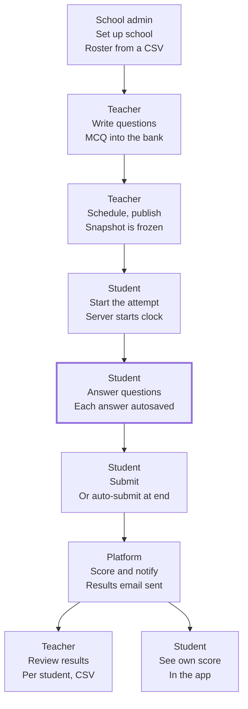

# Online Exams Platform — Vision, Personas & Journeys (BAC-5)

Oct 25, 2026 · @Khushboo

## Vision

Schools and coaching institutes in India run frequent tests on paper or on general form tools, which don't enforce time limits, lose answers when a connection drops, and leave teachers to mark and compile results by hand. The Online Exams Platform lets a teacher publish a timed quiz in minutes, lets a whole class take it at once without losing an answer, and delivers scored results to teachers and students automatically. The school or institute pays, per student per term; students and parents never pay or sign up themselves. The timing is right because competitive entrance exams such as JEE Main and CUET-UG are computer-based, so institutes want realistic practice tests, and because India's DPDP Act raises the bar for handling children's data, which general form tools leave entirely to the school.

**Product in one line:** a timed, auto-scored online exam platform that schools adopt with minimal setup and that fits into the systems they already use.

## Scope

This is an assessment platform, not an LMS: it owns quizzes, attempts and results, and integrates with the systems schools already run instead of replacing them. The school onboards its own teachers and students; we never onboard students directly.

- **POC (Phase 1)** proves one quiz end to end on a laptop: admin sets up a school, a teacher publishes a multiple-choice quiz, students take it, scores are correct.
- **MVP (Phase 2)** is good enough for one real class: classes, scheduling, reliable attempts, emailed results, a basic web client, hosted in the cloud.

### Deliberately out of scope for POC and MVP

| Item | Left out of | Arrives in | Why it waits |
| --- | --- | --- | --- |
| Classes, sections and scheduled start windows | POC | Phase 2 | POC only proves the quiz-to-score path; any student can take any published quiz |
| Autosave, resume after disconnect, auto-submit at deadline | POC | Phase 2 | Reliability is the MVP's core promise and needs the POC's basic attempt model first |
| Emails and reminders | POC | Phase 2 | Needs Kafka and the Notification service; scores are visible through the API in the POC |
| Bulk student import from CSV | POC | Phase 2 | A demo needs a handful of users; a real class needs 40 |
| Web client and cloud hosting | POC | Phase 2 | The POC is demoed through API tests on a laptop |
| School self-sign-up, email verification, password reset, Google sign-in | POC, MVP | Phase 3 | The pilot school is set up by us; resets during the pilot are done by its admin |
| Question types other than multiple choice (true/false, numeric, short text) | POC, MVP | Phase 3 | MCQ covers most school and entrance-exam practice tests and keeps scoring simple |
| Rankings across classes and quizzes, question analytics, large exports | POC, MVP | Phase 3 | Per-quiz results, each student's rank and percentile within the quiz, and a CSV export answer the pilot teacher's first questions |
| Proctoring, including camera and microphone requirements | POC, MVP | Phase 5 | Recording and analysing video is costly, privacy-heavy for minors and not needed for practice tests. Until Phase 5 the product asks for no camera or microphone permission at all; when it does, it asks only as a proctored attempt starts. |
| AI-generated questions and image-based question input | POC, MVP | Phase 5 | External cost and latency; teachers must trust the basic product first |
| LMS integration and webhooks | POC, MVP | Phase 5 | Integration matters once many schools use it; one pilot school does not need it |
| Native mobile apps | POC, MVP | Not planned | A responsive web client works on the phones students already have |
| Billing and payments | POC, MVP | Not planned before launch | The pilot is free; pricing is validated before anything is built |

### Never in scope

Attendance, timetables, fees, course content, live classes, parent communication and report cards. Schools already have systems for these, and building them would add months of CRUD work without the engineering problems this product exists to solve. High-stakes board or entrance exams are also out: the product targets classroom and practice tests, where the legal and proctoring bar is lower.

## Business goals and pilot success metrics

The Phase 2 pilot must prove one thing: a real teacher will run tests on it repeatedly because it saves time and never loses a student's work. The targets below are proposals for you to challenge; each becomes a measurable check at the Phase 2 gate.

| Goal | Metric | Pilot target |
| --- | --- | --- |
| Students never lose work | Answers lost to crashes, disconnects or double submits | 0 |
| Scores are trustworthy | Sampled attempts where the score matches the teacher's manual check | 100% |
| Every attempt ends with a score | Attempts left unscored after the deadline (auto-submit covers walk-aways) | 0 |
| Teachers save time | Time for a teacher to create and publish a 20-question quiz, after the first one | Under 15 minutes |
| Results arrive without chasing | Time from quiz close to results email | Under 5 minutes |
| The teacher comes back | Quizzes the pilot teacher runs over 4 weeks | At least 3 |
| Students can actually take it | Rostered students who complete each quiz on their own device | At least 90% |
| The teacher would keep using it | Teacher's answer to "would you use this next term?" | Yes |

Beyond the pilot, the business goals are self-serve adoption by any school (Phase 3) and reliable exam-start bursts of thousands of students (Phase 4).

## Personas

Three primary personas use the product; the teacher is the one the pilot must win, because she decides whether it gets used again.

| Persona | Goals | Frustrations today | Devices and network | Tech comfort |
| --- | --- | --- | --- | --- |
| **Priya, teacher** (32, teaches Class 9–10 maths, 4 sections of about 40 students) | Run a weekly test without spending her weekend marking; see which topics a class is weak in; send results the same day | Marking 160 papers by hand; Google Forms has no real timer and lets students reopen the form; compiling marks into the school's spreadsheet | School laptop or her own laptop; Android phone; school Wi-Fi is unreliable | Medium: comfortable with Google Forms, WhatsApp and Excel; no patience for long setup |
| **Arjun, student** (15, Class 10, preparing for board exams and later JEE) | Practise under real exam timing; know his score and mistakes quickly | Losing answers when the network drops; unclear whether a submission went through; waiting days for marks | Shared family Android phone, sometimes a computer-lab PC; patchy 4G at home | High on phones; low patience for anything slow or confusing |
| **Mr. Rao, school admin** (45, runs the school office and its records) | Get all teachers and students on the platform with little effort; control who has access; keep parents' trust on data | Onboarding every new tool one user at a time; chasing teachers for marks; worry about student data leaks | Office desktop | Low to medium: works from spreadsheets and the school's management software |

Secondary stakeholders have no login in the POC or MVP:

- **Parents** care about scores and their child's data. Consent and communication go through the school.
- **Coaching institute owner** is a variant of the admin: more tests, larger batches, focused on entrance-exam practice. The same product serves both.
- **Platform operator (you)** sets up the pilot school and watches the system during exam windows.

## User journeys

One quiz passes through four hands: the admin sets up once, the teacher authors and publishes, students answer, and the platform scores and reports without the teacher marking anything.

*MVP journey for one quiz: 4 actors, 9 steps. The highlighted step, autosave, is judged by zero lost answers.*

The journeys below are written for the MVP. The failure cases under each are where the engineering lives, so they matter as much as the happy path.

### 1. Teacher creates and schedules a quiz

1. Priya logs in on her laptop and opens the Class 10 maths question bank.
2. She adds 20 multiple-choice questions, some with more than one correct option.
3. She creates a quiz from them: 30 minutes, marks per question, a start window of Monday 10:00–10:15, assigned to section 10-B.
4. She previews it as a student would see it.
5. She publishes it. The quiz is frozen as a snapshot, and students in 10-B see it under Upcoming.

When things go wrong:

- She spots a typo after publishing. Before the exam she edits and republishes. From 5 minutes before the window opens until the quiz closes, the quiz is locked, so the paper never changes mid-exam.
- She assigns the wrong section. She can reassign until 5 minutes before the start window opens, not after.

### 2. Student takes a timed quiz

1. Arjun logs in on the family phone with his school username.
2. The quiz opens at 10:00; he starts at 10:04. The server records his deadline, and a countdown shows on screen.
3. He answers; each answer is saved as he moves on.
4. He submits, sees a confirmation, and sees his score if the teacher allows it.

When things go wrong:

- His network drops at question 12. He reopens the quiz and resumes at question 12 with all answers kept. The clock kept running while he was away.
- He taps Submit twice on a slow connection. Only one submission is recorded.
- His phone dies. At the deadline the attempt is submitted automatically with the answers saved so far.
- He tries to start at 10:20, after the window closed. He is told the window has closed and is not let in.
- An answer arrives after his deadline. The server rejects it, whatever his screen showed.

### 3. Teacher reviews results

1. When the quiz closes, Priya gets an email with the class average and a link to the results.
2. She sees each student's score and who didn't attempt.
3. She opens one student's attempt to see the answers given.
4. She exports a CSV and copies the marks into the school's register.

When things go wrong:

- A student disputes a score. Priya opens the attempt beside the answer key of the exact version the student took.
- The email provider is down. The email is retried later, and results stay available in the app meanwhile.

## Assumptions, open questions and review

### Assumptions

- The pilot is one teacher and one class of about 40 students running low-stakes practice tests.
- Many students under 18 have no email address, so students log in with a school-issued username and password; email is optional for them.
- Results emails go to the teacher; students see their score in the app, and by email only if they have an address.
- The interface is English only; times are shown in IST and stored in UTC.

### Open questions

- [ ] Who is the pilot teacher or school? Needed by the Phase 2 gate.
- [x] What do students see after a quiz? Decided 26 Oct 2026: the teacher chooses per quiz whether students see their score, the correct answers, and their rank and percentile. Negative marking is also chosen per quiz.
- [x] Can a teacher allow more than one attempt per student? Decided 26 Oct 2026: no, one attempt per quiz in the POC and MVP.
- [ ] Does the pilot start with a school or a coaching institute?

### What this feeds

- **BAC-6 (functional requirements):** each journey step becomes a use case; the failure journeys become alternate flows.
- **BAC-7 (non-functional requirements):** zero lost answers, the 5-minute results target, exam-start bursts and children's data obligations become measurable NFRs.

### Your PM review: defend these before we close BAC-5

Answer each in two or three sentences in a comment; I'll push back like a product manager.

- [ ] Why would a school pay for this instead of using Google Forms for free?
- [ ] Why does the school pay and not the students, when students benefit most?
- [ ] Teachers may expect an online exam product to proctor. How do you set that expectation in the MVP, and why is it safe to leave proctoring until Phase 5?
- [ ] Why is multiple choice enough for the MVP?
- [ ] Which single metric would make you call the pilot a failure, and why that one?
